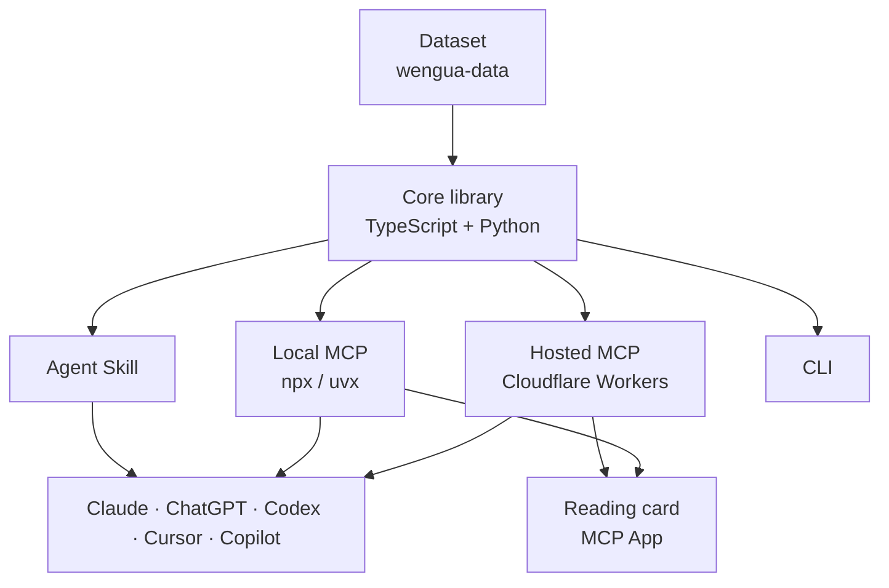

# Ecosystem overview

Every Wengua surface is a thin layer over the same dataset and core, so a reading is identical whether it comes from a skill, the CLI or the hosted server.

## Which one should I use?

| You are… | Use |
|---|---|
| Chatting in Claude.ai or ChatGPT | The hosted MCP server (paste a URL) |
| Using Claude Code, Codex, Cursor or Copilot | The Agent Skill, or the local MCP server |
| In a terminal or scripting | The CLI |
| Building your own app | The core library or the dataset |
