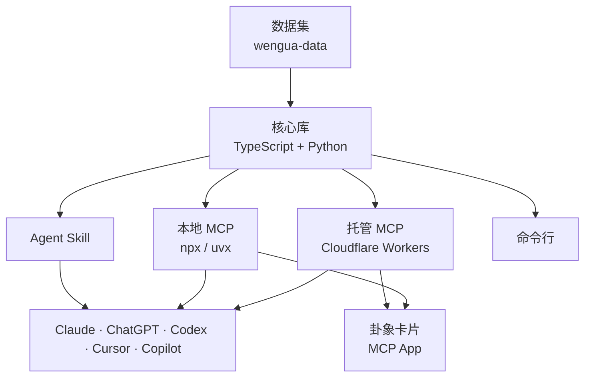

# 生态总览

问卦的每一种用法都只是同一套数据集和核心之上的薄薄一层，所以无论来自技能、命令行还是托管服务，同一次起卦的结果都完全一样。

## 我该用哪一个？

| 你在…… | 用 |
|---|---|
| 在 Claude.ai 或 ChatGPT 里聊天 | 托管 MCP 服务（贴一个网址） |
| 使用 Claude Code、Codex、Cursor 或 Copilot | Agent Skill，或本地 MCP 服务 |
| 在终端里或写脚本 | 命令行 |
| 开发自己的应用 | 核心库或数据集 |
